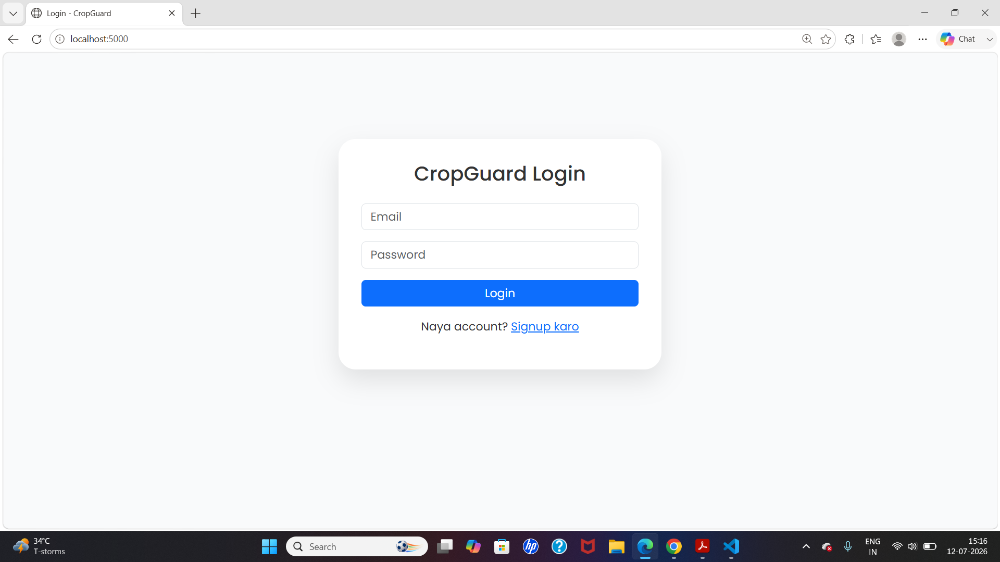
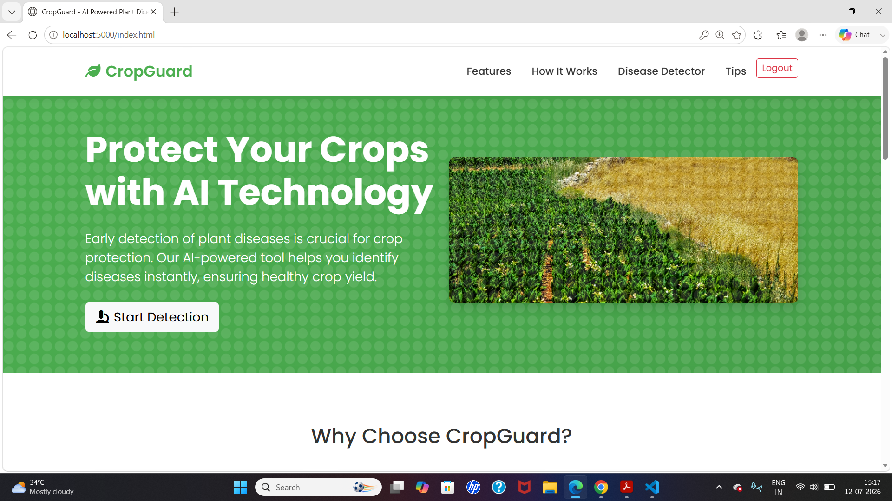
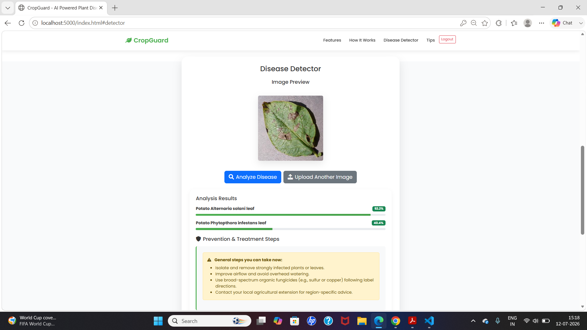

<div align="center">

# 🌿 CropGuard
### AI-Powered Plant Disease Detection & Prevention System

Detect plant diseases instantly using AI — just upload a photo and get results in seconds.


</div>

---

## 📖 About The Project

**CropGuard** helps farmers and gardeners detect plant diseases early by simply uploading a photo of an affected leaf. Powered by an AI image-recognition model, it instantly analyzes the image and tells you what disease it might be — helping protect crop yield before it's too late.

The app also has **secure login/signup**, so every user gets their own protected dashboard.

---

## 🖼️ Screenshots

> 📌 *Add your own screenshots here after running the app — just replace the image links below.*
> *(Take a screenshot, save it inside a folder named `screenshots` in your project, then link it like shown.)*

| Login Page | Dashboard | Disease Detection Result |
|:---:|:---:|:---:|
|  |  |  |

---

## ✨ Features

- 🔐 **Secure Authentication** — Signup & Login with encrypted (hashed) passwords
- 🎫 **JWT Token-Based Sessions** — Stay logged in safely
- 🤖 **AI Disease Detection** — Upload a leaf photo, get instant AI analysis
- 📤 **Drag & Drop Upload** — Simple, no-fuss image upload
- 📱 **Fully Responsive** — Works on mobile, tablet, and desktop
- 🚪 **Protected Dashboard** — Only logged-in users can access the detector
- 🚦 **Logout Anytime** — One-click secure logout

---

## 🛠️ Built With

| Layer | Technology |
|---|---|
| Frontend | HTML5, CSS3, JavaScript, Bootstrap 5, Font Awesome |
| Backend | Node.js, Express.js |
| Database | MongoDB + Mongoose |
| Authentication | JWT (JSON Web Tokens), bcrypt.js |
| AI Model | Roboflow API (Image Classification) |

---

## 🚀 How To Use This Project (Step-By-Step)

Follow these steps exactly, even if you've never done this before 👇

### ✅ Step 1: Install Node.js
Download and install Node.js from [nodejs.org](https://nodejs.org) if you haven't already.

### ✅ Step 2: Download this project
```bash
git clone https://github.com/md-jasim123/crop-disease-and-prevention.git
```
Then move into the folder:
```bash
cd crop-disease-and-prevention
```

### ✅ Step 3: Install all required packages
```bash
npm install
```
*(This installs Express, MongoDB driver, JWT, bcrypt, etc. — everything the app needs.)*

### ✅ Step 4: Set up your environment variables
Create a new file in the project root named exactly **`.env`**, and paste this inside:
```env
MONGO_URI=your_mongodb_connection_string_here
JWT_SECRET=any_random_secret_text_here
```
> 🔑 Get your `MONGO_URI` from [MongoDB Atlas](https://cloud.mongodb.com) (free account).

### ✅ Step 5: Start the server
```bash
npm start
```
You should see:
```
Backend is running on port 5000
MongoDB connected successfully
```

### ✅ Step 6: Open the app in your browser
```
http://localhost:5000
```
This opens the **Login Page**.

### ✅ Step 7: Create an account
- Click **"Signup karo"** link on the login page
- Fill in your name, email, and password
- Click **Signup**

### ✅ Step 8: Log in
- Go back to the login page
- Enter your email & password
- Click **Login**

You'll be redirected to the **Dashboard** automatically. 🎉

### ✅ Step 9: Detect a plant disease
1. Scroll to the **"Disease Detector"** section
2. Click **"Choose Image"** and upload a photo of a plant leaf
3. Click **"Analyze Disease"**
4. Wait a few seconds — the AI will show you the result with the detected disease name

### ✅ Step 10: Logout
Click the **Logout** button in the top navigation bar anytime to securely sign out.

---

## 📂 Project Structure

```
crop-disease-and-prevention/
├── config/
│   └── db.js              → MongoDB connection
├── middleware/
│   └── auth.js             → JWT verification (protects routes)
├── models/
│   └── User.js              → User database schema
├── routes/
│   └── authRoutes.js        → Signup & Login API routes
├── public/
│   ├── index.html            → Main dashboard (protected page)
│   ├── login.html             → Login page
│   ├── signup.html            → Signup page
│   ├── script.js
│   └── style.css
├── serr.js                    → Main server file (entry point)
├── .env                        → Secret keys (not uploaded to GitHub)
├── .gitignore
└── package.json
```

---

## 🔐 How Authentication Works (In Simple Words)

1. When you **sign up**, your password is scrambled (hashed) before saving — nobody can read it, even from the database.
2. When you **log in**, the server checks your password and gives you a special digital key called a **JWT token**.
3. This token is saved in your browser and sent every time you visit the dashboard — proving you're logged in.
4. If there's no valid token, you're automatically sent back to the login page.
5. **Logout** simply deletes this token from your browser.

---

## 🌱 Future Improvements

- [ ] Forgot password / reset password feature
- [ ] Save disease detection history per user
- [ ] Email verification on signup
- [ ] Admin dashboard for managing users
- [ ] Multi-language support

---

## 👤 Author

**Md Jasim**

⭐ If you like this project, don't forget to give it a star on GitHub!